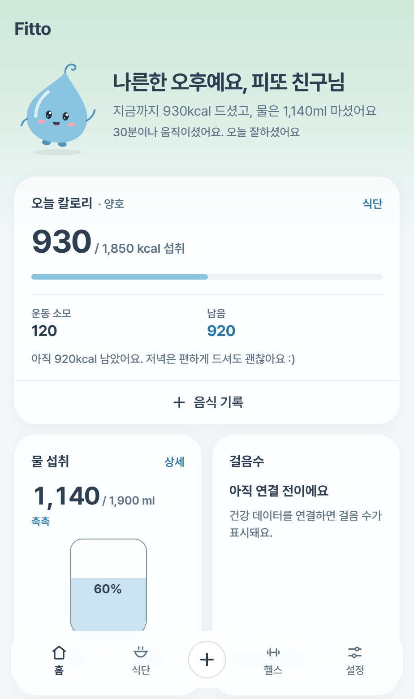
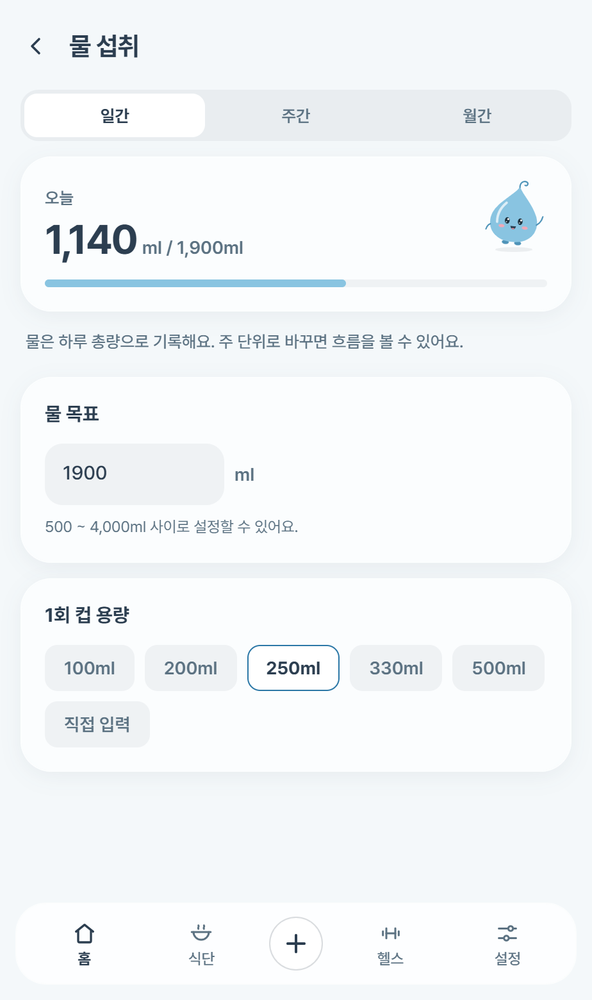
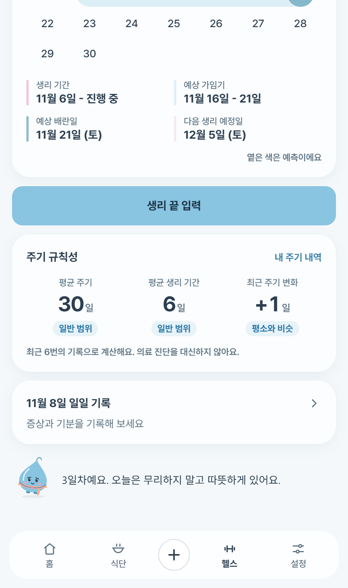
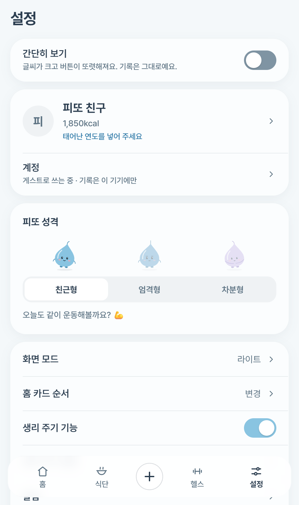
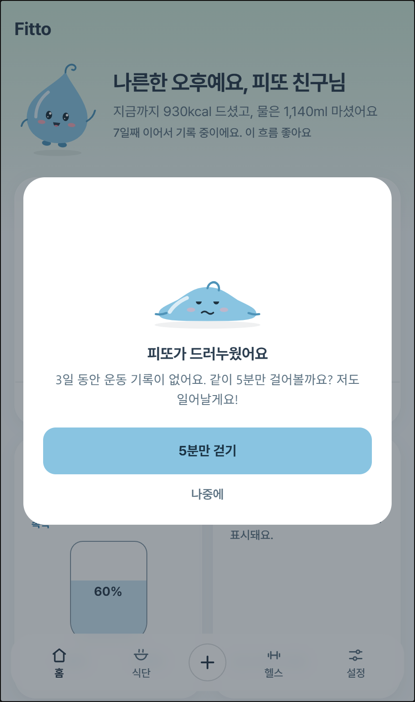
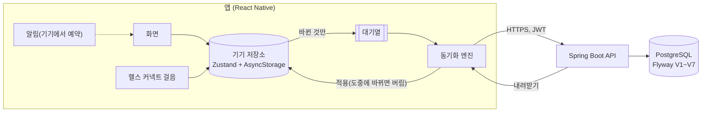

# Fitto (피또)

숫자 대신 캐릭터 표정으로 건강 상태를 알려주는 건강관리 앱.

물을 얼마나 마셨는지, 오늘 얼마나 움직였는지를 숫자로만 보여주면 잘 안 보게 됩니다.
피또는 물방울 캐릭터 "피또"의 표정과 움직임으로 오늘 상태를 먼저 보여주고, 숫자는 그 다음에 둡니다.
가입하지 않아도 모든 기능을 쓸 수 있고, 계정을 만들면 기록이 서버에 백업됩니다.

> React Native 앱과 Spring Boot 서버를 혼자 만든 풀스택 프로젝트입니다. 기획, 캐릭터와 화면 디자인, 앱, 서버, 배포, 약관까지 직접 맡았습니다. 출시 준비를 마치고 지금은 APK 비공개 테스트를 진행하고 있습니다.
>
> 기획 2026년 4월 → Next.js 웹 프로토타입 2026년 5~6월 → 2026년 8월 앱과 서버로 처음부터 다시 만들어 진행 중
>
> 앱 약 2.5만 줄, 서버 약 7천 줄 / 서버 테스트 73개, 앱 점검 스크립트 10종

## 화면

| 홈 | 물 상세 | 생리 주기 | 피또 성격 | 운동 3일 쉼 |
| --- | --- | --- | --- | --- |
|  |  |  |  |  |

피또는 성격 3종(친근, 엄격, 차분) × 상황 11가지로 33장입니다. 물을 마실수록 표정이 바뀌고 둥둥 뜨는 속도가 빨라집니다. 화면은 예시 데이터로 찍었습니다.

## 핵심 결정

**웹 프로토타입을 접고 앱으로 다시 만들었습니다.**
헬스케어 앱은 접근성이 좋아야 합니다. 건강 기록은 생각났을 때 바로 남길 수 있어야 이어지는데, 웹은 브라우저를 열고 주소를 찾아 들어가야 합니다. 웹과 앱을 둘 다 만들 필요는 없다고 보고 Next.js 웹 프로토타입을 접은 뒤 앱 하나에 집중했습니다. 앱이라서 기록 알림, 헬스 커넥트 걸음 수, 지문이나 얼굴로 여는 잠금처럼 폰에 있어야 쓸 수 있는 기능을 넣을 수 있었습니다.

**가입 없이 모든 기능을 쓰게 했습니다.**
건강 기록 앱은 첫 화면에서 가입을 요구하면 써 보기도 전에 떠납니다. 그래서 기록은 항상 기기 저장소에 먼저 쓰고, 계정이 있을 때만 대기열(outbox)이 뒤에서 서버로 올립니다. 화면은 서버를 기다리지 않고, 네트워크가 끊겨도 기록이 막히지 않습니다. 대기열에는 값이 아니라 "무엇이 바뀌었는지"만 담아, 물 컵을 다섯 번 눌러도 요청은 한 번입니다. → [설계노트 12장](docs/피또_설계노트.md#12-앱과-서버를-잇는-방식--로컬-우선과-대기열)

**잠든 서버는 먼저 깨우고 진짜 요청은 한 번만 보냅니다.**
무료 서버는 15분 쉬면 잠들고 다시 깨는 데 실측 93.8초가 걸리는데, iOS는 요청을 60초에 스스로 끊습니다. 가입 요청을 재시도하면 서버가 깨어난 뒤 두 번 처리할 수 있어서, 아무 일도 하지 않는 `/health`로 깨운 뒤 본 요청을 한 번만 보냅니다. → [설계노트 8장](docs/피또_설계노트.md#잠든-서버를-깨우는-첫-요청은-폰이-먼저-끊어버립니다)

**위험한 설정이면 서버가 뜨지 않게 했습니다.**
개발용이거나 너무 짧은 JWT 키, 비어 있는 운영 설정, 모든 출처(`*`)나 개발용 주소를 허용하는 CORS, 스키마를 자동으로 바꾸는 `ddl-auto=update`, 인증 코드를 로그에 찍는 설정이 운영에 섞이면 부팅을 실패시킵니다(`StartupSecurityCheck`). 앱도 http 주소로 빌드되면 첫 실행에서 멈춥니다. 기본값이 있으면 설정을 빠뜨린 채 배포해도 겉으로는 정상으로 보이기 때문입니다.

**체중 증감 색은 "줄면 좋음"이 아니라 목표 방향으로 정합니다.**
증량이 목표인 사람에게 감소를 초록으로 칠하면 반대로 읽힙니다. 같은 원칙으로 피또는 사실과 다른 말을 하지 않습니다. 걸음을 연결하기 전에는 "어제 많이 걸으셨으니"라고 하지 않고, 쓰지도 않은 날을 "운동 안 한 날"로 세지 않습니다.

## 구조



- 화면은 기기 저장소만 읽고 씁니다. 서버와 이야기하는 건 동기화 계층뿐입니다
- 올린 뒤에 받습니다. 받는 사이 기기에서 기록이 바뀌었으면 받은 결과를 버리고 다음에 다시 받습니다(서버의 옛 값이 방금 기록을 덮지 않게)
- 서버 쪽 사용자 구분은 토큰으로만 합니다. 사용자 ID를 경로나 파라미터로 받는 API가 없습니다

## 기술 스택

| 영역 | 사용 |
| --- | --- |
| 앱 | Expo SDK 57, React Native 0.86, React 19, TypeScript(strict) |
| 상태 | Zustand + AsyncStorage(버전 마이그레이션 v10), 토큰은 OS 보안 저장소 |
| 화면과 움직임 | React Navigation 7, Reanimated 4, Gesture Handler, react-native-svg |
| 기기 기능 | 헬스 커넥트 걸음, 생체 인증 잠금, 기기 알림 예약. Expo에 없는 "정확한 알람 권한 확인"과 "헬스 커넥트 권한 안내 화면 열기"는 Kotlin으로 직접 만든 모듈 2개 |
| 서버 | Spring Boot 4.1, Java 21, Spring Security, JWT(jjwt), refreshToken 회전과 재사용 감지 |
| DB | PostgreSQL(운영 Neon), Flyway |
| 배포 | Render(Docker), EAS Build, GitHub Pages(약관 페이지) |
| 검사 | GitHub Actions: PR마다 앱 타입 검사, 점검 스크립트 10종, 서버 JUnit 테스트 |

## 만드는 방식

- **결정은 이유와 함께 남깁니다.** 무엇을 왜 골랐는지, 어떤 사고가 있었는지를 [설계노트](docs/피또_설계노트.md)에 "상황, 선택, 이유"로 적습니다. 코드 주석도 "무엇"보다 "왜"를 씁니다
- **AI 도구와 함께 만듭니다.** 구현 방식을 여러 개 비교해 고르고, 보안처럼 민감한 부분은 Claude Code, Claude, ChatGPT 세 도구로 교차 검증합니다. 그대로 믿지 않고, 지적은 코드와 운영 환경에서 직접 재현해 확인한 뒤 고칩니다
- **배포 전 보안 점검을 영역별로 나눠 했습니다.** 인증, 권한, 에러 메시지, 로그, 요청 크기 등 13개 영역을 체크리스트로 점검했습니다
- **AI 코드 리뷰를 받고 반영했습니다.** 별도 AI 세션에 리뷰를 맡겨 동기화 경쟁 상태, 토큰 동시 갱신, 서버 일시 오류를 영구 거절로 세던 문제를 고쳤습니다. "접속 IP가 위조될 수 있다"는 지적은 운영 서버에 위조 헤더를 보내 재현한 뒤 고쳤습니다. "자동 백업에 기록이 들어간다"는 지적은 실제 백업 규칙을 열어 보고 틀린 것을 확인해 반영하지 않았습니다
- **검사는 사람이 기억하지 않게 했습니다.** PR마다 CI가 돌고, 통과해야 main에 들어갑니다. 앱과 서버에 따로 있는 목표 칼로리 공식은 같은 예시 파일로 함께 검사합니다

## 문제 해결 사례

- [토큰 탈취를 감지하고도 막지 못한 문제](docs/피또_설계노트.md#토큰-탈취를-감지하고도-막지-못한-문제)
- [응답을 같게 맞췄는데도 가입 여부가 새어 나간 문제](docs/피또_설계노트.md#응답을-같게-맞췄는데도-가입-여부가-새어-나간-문제)
- [올리지 못한 기록이 조용히 사라지고 있었습니다](docs/피또_설계노트.md#올리지-못한-기록이-조용히-사라지고-있었습니다)
- [접속 IP를 헤더 하나로 바꿀 수 있었던 것](docs/피또_설계노트.md#12-24-접속-ip를-헤더-하나로-바꿀-수-있었던-것) (고치고 배포했더니 이번엔 모든 사용자가 Cloudflare 주소 하나로 묶였던 것까지)

## 실행

```bash
npm install
npm start
```

Expo Go 앱으로 QR을 찍거나, `npm run android`, `npm run ios`, `npm run web`으로 실행합니다. `npm run check`는 점검 스크립트를 모두 돌립니다.

피또 캐릭터 그림(`src/theme/fittoSvgs.ts`)은 저장소에 올리지 않습니다. 저장소만 받았다면 빈 물방울로 대신해 실행할 수 있습니다.

```bash
cp src/theme/fittoSvgs.placeholder.ts src/theme/fittoSvgs.ts
```

원본 SVG 폴더가 있으면 `node scripts/build-fitto-svgs.mjs <폴더>`로 만들고, 앱 빌드(EAS)에는 `.easignore`로 포함됩니다.

서버는 `server/`에 있습니다. 필요한 환경변수는 `server/.env.example`에 있습니다.

## 문서

- [설계노트](docs/피또_설계노트.md): 결정과 트러블슈팅
- [API 명세서](docs/피또_API_명세서_v1.1.md): 엔드포인트, 계산 규칙, 에러 코드, 권한 모델
- [배포와 배포 후 확인](server/DEPLOY.md): 운영 서버에 직접 보내 보는 확인 절차
- [약관과 개인정보처리방침](https://jangeunyeong01.github.io/Fitto/): `src/data/terms.ts` 하나에서 앱 화면과 웹 페이지가 함께 나옵니다

## 다음 단계

- 비공개 테스트 피드백 반영
- 처방약 복용 기록과 알림(설계 중)
- 식약처 식품영양성분 API로 음식 검색과 영양 분석 바꾸기
- 실제 PostgreSQL로 DB 마이그레이션 검증(지금 서버 테스트는 H2)
- 성격마다 다른 피또 움직임, 레시피 사진

## 라이선스

코드는 [MIT](LICENSE)입니다. 피또 캐릭터 디자인과 화면 캡처(`docs/screenshots/`)는 MIT에 포함되지 않습니다.
번들된 Pretendard 폰트는 SIL Open Font License 1.1을 따릅니다(`assets/fonts/Pretendard-LICENSE.txt`).
